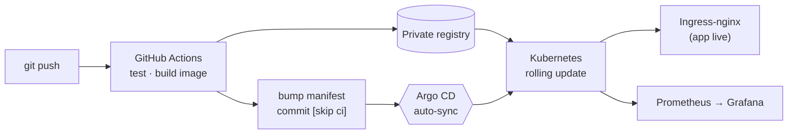

# cicd-k8s-lab — CI/CD + Kubernetes (GitOps)


> Một pipeline CI/CD **hiện đại, hoàn chỉnh**, tự tay dựng và **chạy thật**: một `git push` là code tự
> build → đóng image → cập nhật manifest → **Argo CD tự đồng bộ** → rolling update trên Kubernetes,
> kèm giám sát Prometheus/Grafana. Đủ 5 mảnh: **CI → Registry riêng → GitOps → Kubernetes → Monitoring**.



### Chứng minh điều gì
CI/CD · GitOps (declarative, Git là nguồn sự thật) · Kubernetes (Deployment/Service/Ingress/probes/rolling
update) · container hoá · registry riêng · observability · scripting bootstrap idempotent. **Không ai
`kubectl apply` tay** — CI chỉ *ghi vào Git*, Argo CD *đọc từ Git* rồi tự đồng bộ cluster.

### Sự cố kỹ thuật đã tự chẩn đoán & fix (không chỉ chạy theo tutorial)
- **YAML `${{ }}` trong flow-mapping `{ }`** → cặp `}}` xung đột `}` đóng mapping → workflow **startup_failure** (`jobs:[]`). Fix: block-style `with:`.
- **Argo CRD > 262KB** → `kubectl apply` client-side fail annotation limit → dùng `--server-side --force-conflicts`.
- **`docker push` báo "HTTP response to HTTPS client"** → tách tên push `localhost:5000` (HTTP) vs tên in-cluster `k3d-registry.localhost:5000` (pull) — cùng registry.
- **Background job chết khi session đóng** → chạy dưới `systemd-run` thay vì `nohup`.
- **Giới hạn RAM WSL** làm OOM stack monitoring → điều chỉnh `.wslconfig`, không đụng dịch vụ đang chạy.

## Vòng đời (điều bạn sẽ thấy tận mắt)

```
  sửa app/ ─► git push main
                  │
                  ▼
        GitHub Actions (self-hosted runner trong WSL2 @150)
          1. npm test
          2. docker build ─► push  k3d-registry.localhost:5000/lab-app:<sha>
          3. sed tag mới vào deploy/app/deployment.yaml ─► git commit "[skip ci]"
                  │
                  ▼   (GitOps: Git là nguồn sự thật duy nhất)
        Argo CD @k3d  phát hiện commit ─► sync ─► rolling update Deployment
                  │
                  ▼
        Pod mới chạy ─► Ingress-nginx ─► http://lab-app.localhost:8080
        Prometheus scrape /metrics ─► Grafana vẽ biểu đồ
        Rollback = git revert (Argo tự kéo về bản cũ)
```

Khác biệt cốt lõi vs pipeline HTC (`_cicd` bên repo ERP): ở đây **không ai `kubectl apply` tay** — CI chỉ *ghi vào Git*, Argo CD *đọc từ Git* rồi tự đồng bộ cluster. Đó là **GitOps**.

## Cây thư mục

```
app/                    App mẫu Node (Express): / /healthz /readyz /metrics
  Dockerfile            multi-stage, non-root, có HEALTHCHECK
deploy/app/             Manifest k8s (Argo CD theo dõi thư mục này)
  deployment.yaml         2 replica, probe, resource limit, rolling update
  service.yaml / ingress.yaml / servicemonitor.yaml / kustomization.yaml
argocd/application.yaml Khai báo Argo CD Application -> trỏ deploy/app
.github/workflows/ci.yml CI: test + build + push + bump tag
bootstrap/
  bootstrap.sh          Dựng CẢ cụm 1 lệnh (k3d+registry+ingress+argo+monitoring)
  teardown.sh           Xoá sạch làm lại
```

## Cài đặt (trên máy 150, trong WSL2)

Điều kiện: Docker đang chạy. Script tự cài `kubectl`, `helm`, `k3d` nếu thiếu.

```bash
# 1) Đưa repo này lên GitHub trước (Argo CD cần đọc manifest từ Git)
git init && git add -A && git commit -m "init lab"
git remote add origin https://github.com/<you>/cicd-k8s-lab.git && git push -u origin main

# 2) Dựng cả cụm (truyền REPO_URL để Argo trỏ đúng repo)
REPO_URL=https://github.com/<you>/cicd-k8s-lab.git ./bootstrap/bootstrap.sh
```

Xong, script in ra mật khẩu Argo CD + Grafana. Thêm vào **hosts** (Windows: `C:\Windows\System32\drivers\etc\hosts`):

```
127.0.0.1 lab-app.localhost argocd.localhost grafana.localhost k3d-registry.localhost
```

Truy cập (qua ingress cổng **8080**):
- App: http://lab-app.localhost:8080/
- Argo CD: http://argocd.localhost:8080/ (`admin` / mật khẩu script in ra)
- Grafana: http://grafana.localhost:8080/ (`admin` / `prom-operator`)

## Nối CI (để tự động hoàn toàn)

Cài **GitHub self-hosted runner trong WSL2 @150** với label `k3d-150` (phải thấy `docker` và registry):
```
# GitHub repo -> Settings -> Actions -> Runners -> New self-hosted (Linux x64)
# khi hỏi labels: thêm  k3d-150
./run.sh    # hoặc cài service: sudo ./svc.sh install && sudo ./svc.sh start
```
Từ đó: sửa `app/server.js` → `git push` → xem Argo CD tự rollout. Trang `/` đổi `version` = `<sha>` và `pod` = tên pod mới.

## Thử vòng lặp bằng tay (không cần runner)

```bash
cd app
docker build --build-arg APP_VERSION=test1 -t k3d-registry.localhost:5000/lab-app:test1 .
docker push k3d-registry.localhost:5000/lab-app:test1
# sửa tag trong deploy/app/deployment.yaml thành :test1, commit, push
# -> Argo CD sync trong ~1 phút (hoặc bấm "Sync" trong UI)
```

## Gotcha đã xử lý sẵn
- **Tên registry 2 phía**: `k3d-registry.localhost:5000` dùng chung cho cả host (push) lẫn cluster (pull) nhờ dòng `/etc/hosts` + `--registry-use`. Đây là lỗi hay gặp nhất với k3d.
- **k3d thay k3s trần**: WSL2 hay vướng systemd; k3d chạy trong Docker nên né hẳn.
- **Traefik bị tắt** (`--disable=traefik`) để dùng **ingress-nginx** chuẩn công nghiệp.
- **Prometheus không thấy app**: đã set `serviceMonitorSelectorNilUsesHelmValues=false` + label `release: monitoring` trên ServiceMonitor.
- **`[skip ci]`** trong commit bump-tag để CI không tự kích lại vô tận.
- **Argo TLS**: bật `server.insecure` cho UI chạy sau ingress-nginx (chỉ hợp lab).

## Bước mở rộng (khi vòng cơ bản đã chạy)
- Thêm **staging/prod** = 2 thư mục overlay Kustomize + 2 Argo Application (app-of-apps).
- **Sealed-secrets / SOPS** để đưa secret vào Git an toàn.
- **Argo Rollouts** cho canary/blue-green.
- Multi-node thật: nối 83 làm worker qua Tailscale.
- Gắn **Kafka lab** sẵn có (broker 150) làm dependency để học Service/NetworkPolicy.
```
